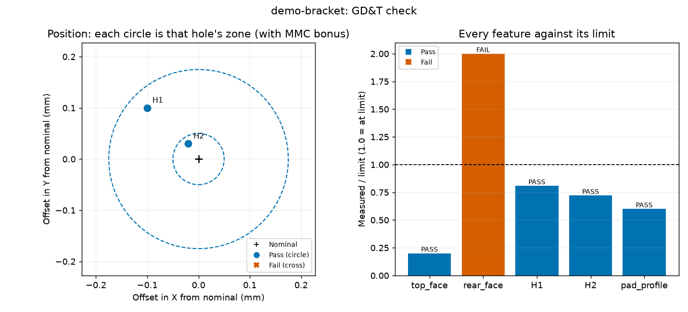

# gdt-inspection-checker

I built a Python tool that checks a measured part against its drawing's tolerances because checking datums, position and flatness by hand is slow, and it is easy to get the math wrong.

A drawing does not only give sizes. It also says how straight a face must be, how square it must stand, and how far each hole can sit from its planned spot. These rules are called GD&T (geometric dimensioning and tolerancing). To check a real part, someone measures points on it, works out a reference frame from three faces called datums A, B and C, and then does the geometry for each rule. I wanted a tool that does all of that the same way every time, and that tells me pass or fail for each feature.

## What it does, in plain terms

You give it two files:

1. **A part spec** (a small text file, TOML format). It lists the datums and each feature with its tolerance. For example: "the top face must be flat to 0.05 mm" or "this hole must be within 0.25 mm of its planned spot."
2. **Measured points** (a CSV file). Each row is one point touched on the part: which feature it belongs to, and its x, y and z position.

The tool then:

- builds the reference frame from datums A, B and C, the same way a machinist lines a part up on a surface plate;
- measures each feature in that frame;
- compares each result to its tolerance, including the bonus tolerance that some holes get when they are not at their tightest size;
- writes a report that says pass or fail for every feature, and a picture of the results.

## How to try it

You need Python 3.11 or newer.

```bash
git clone https://github.com/jackaI1/gdt-inspection-checker.git
cd gdt-inspection-checker
python -m venv .venv
source .venv/bin/activate
pip install -e ".[test]"

gdt-check examples/bracket_spec.toml examples/bracket_measurements.csv \
  --report output/report.md --plot output/plot.png
```

The command prints one line per feature and exits with code 0 if everything passes, 1 if something fails, and 2 if a file is wrong.

The example is a small mounting bracket. Its output looks like this:

```
top_face       flatness         measured   0.0100  limit   0.0500  PASS
rear_face      perpendicularity measured   0.2000  limit   0.1000  FAIL
H1             position         measured   0.2828  limit   0.3500  PASS
H2             position         measured   0.0721  limit   0.1000  PASS
pad_profile    profile          measured   0.0600  limit   0.1000  PASS

4 of 5 features pass; failed: rear_face
```

The rear face leans 0.2 mm over 10 mm of height, which is twice what its 0.1 mm tolerance allows, so it fails on purpose. The hole H1 is 10.0 mm across, and its tolerance grows by 0.1 mm because it is bigger than its smallest allowed size. That bonus is what lets it pass.

The plot shows the position check on the left: each circle is the tolerance zone for one hole, and a dot inside its circle is a pass. On the right, every feature is shown against its limit, with the failing one in a different colour and labelled FAIL.



## Writing your own spec

Copy `examples/bracket_spec.toml` and change it. The feature types are:

| Type | What it checks | Tolerance |
| --- | --- | --- |
| `datum` | A, B or C: the three faces that set the frame | none |
| `flatness` | how flat a surface is | the full thickness of the zone |
| `perpendicularity` | how square a face stands to datum A | the full thickness of the zone |
| `position` | how far a hole or pin sits from its planned spot | the diameter of the zone |
| `profile` | how far a surface strays from a flat shape at a set height | the full band width |

For holes and pins, `material_condition = "MMC"` turns on the bonus tolerance and `"RFS"` turns it off.

## How it works, in more detail

The main parts are small and each one does one job.

- **Plane and circle fits.** A face is a cloud of points, so the tool finds the flat plane that fits them best (least squares, using a singular value decomposition, which is a standard way to fit a line or plane to points). A hole is fitted with a circle the same way.
- **Datum frame.** Plane A gives the z direction. Plane B, with its z part removed, gives x. Their y direction comes from the cross product, which keeps the frame right-handed. The origin is the single point where all three planes meet.
- **Flatness.** This uses the minimum zone, which is how the standard defines flatness: the thinnest pair of parallel planes that enclose every point. A linear program (an optimisation solver from SciPy) finds the best slab, then a small search tilts it a little further to get the thinnest result.
- **Position.** The deviation of a hole centre from its planned spot is doubled to get the diameter of the zone, which is how position is written on a drawing.

The test suite checks each piece against values I worked out by hand on paper. For example, the datum frame test shifts three planes by 10, 20 and 5 mm and checks that the origin moves by exactly that much.

## What was built

- `src/gdt_checker/geometry.py`: plane and circle fits, the datum frame, and the zone calculations.
- `src/gdt_checker/checker.py`: reads the spec and the CSV, and checks every feature.
- `src/gdt_checker/report.py`: writes the Markdown report and the PNG plot.
- `src/gdt_checker/cli.py`: the `gdt-check` command.
- `examples/`: the bracket spec, its measured points, and the report and plot it makes.
- `tests/`: 20 tests, with hand-calculated expected values.
- `docs/asme_y14_5.md`: which parts of the GD&T standard are implemented, how each is calculated, and what is left out.
- `.github/workflows/tests.yml`: runs the tests and the example check on GitHub for every change.

## What it does not do

It does not cover every GD&T rule. Straightness, cylindricity, runout and other symbols are not implemented, and the datum handling is simpler than a real inspection set-up. Holes are assumed to stand straight up from datum A. The full list and the reasons are in [docs/asme_y14_5.md](docs/asme_y14_5.md).

## Tests and CI

- 20 unit tests, all passing locally with `pytest`.
- The GitHub Actions workflow runs the same tests on Python 3.12 on every pull request, then runs the example check and confirms that the report and plot are written.
